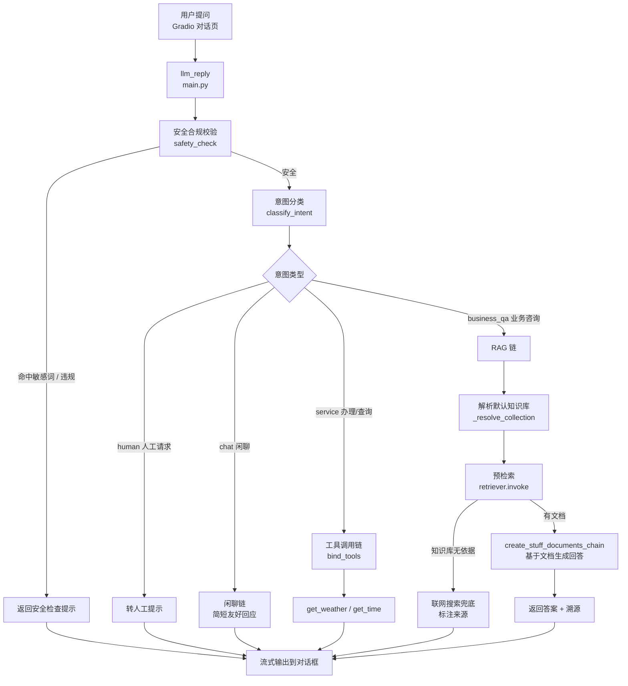
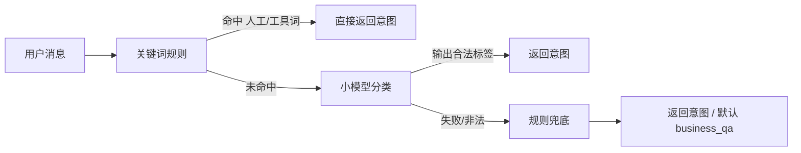
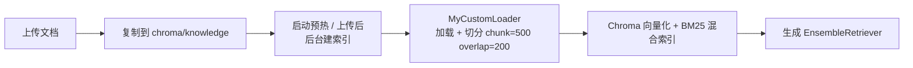
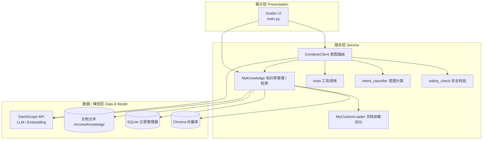

# 电商智能客服系统

> 基于 RAG（检索增强生成）+ 意图路由的电商智能客服，支持多格式文档解析、精准知识检索、多意图分派、内容安全合规与知识库可视化管理。

## ✨ 核心功能

- **多意图路由**：轻量意图分类（小模型分类 + 关键词规则兜底），把用户消息分派到业务咨询 / 工具调用 / 闲聊 / 转人工四条链路。
- **RAG 问答（有据可依）**：业务咨询优先走文档知识库检索，**有依据就用文档作答并附溯源**；知识库里没有依据时改用**联网搜索**兜底，并标注结果来源。
- **工具调用**：办理类/查询类意图走工具调用，内置查天气、查时间两个演示工具。
- **内容安全合规**：两级校验——先敏感词匹配，未命中再交大模型二次判断，违规内容直接拦截。
- **ChatGPT 式界面**：左侧浅灰会话栏（新对话 / 历史会话 / 底部管理入口），中间窄对话列 + 底部圆角输入条（圆形发送键），用户气泡靠右、助手纯文本靠左。
- **满意度评分**：有回答的对话才会出现 1-5 分打分条（点数字即提交，可改分），分数落到 `db/conversations.db`。
- **运营数据看板**（`/dashboard`）：对话总数、问答总量、已评分对话、评分覆盖率、平均满意度，满意度分布与近 14 天对话量，以及最近评分明细。
- **知识库可视化管理**：上传、列表、删除文档，并可查看文档切分后的分块。

## 🏗️ 请求链路图

下图是**一次用户提问**从进入到返回答案的完整链路：



**意图分类**（`classify_intent`）内部流程：



**知识库入库链路**（上传 → 索引）：



## 🧩 系统分层架构



> 箭头方向表示**调用关系**：展示层触发服务层，服务层访问数据 / 模型层；`ROUTER`（意图路由）与 `KB`（知识库）都会调用 DashScope API。

## 📁 模块结构

| 文件 | 职责 |
|---|---|
| `main.py` | Gradio 入口：左侧栏（知识库管理 / 分块查看）+ 对话区布局与事件绑定 |
| `combine_client.py` | `CombineClient`，意图路由核心：`stream` → 闲聊 / 工具 / RAG 三条链 |
| `intent_classifier.py` | 意图分类：`Intent` 枚举 + 关键词规则 + 小模型分类 + 兜底 |
| `safety_check.py` | 安全合规校验：敏感词匹配（`sensitive_words.txt`）+ 大模型二次判断 |
| `knowledge.py` | `MyKnowledge`：上传/列表/删除/分块查看，检索器构建与混合索引 |
| `custom_loader.py` | `MyCustomLoader`：多格式文档加载 + 递归字符切分 |
| `tools.py` | 工具定义：`get_weather`、`get_time` |
| `models.py` | 模型客户端：LLM / Embedding / Rerank |
| `logger.py` | loguru 日志配置 |
| `chat_store.py` | 对话记录持久化：`db/conversations.db`（SQLite），重启后可列出并恢复；含满意度评分与看板统计 |
| `sensitive_words.txt` | 可编辑的敏感词表（改后无需重启） |

## 🔧 技术栈

- **LLM 框架**：LangChain 生态（`langchain-core` / `langchain-classic` / `langchain-community` / `langchain-openai` / `langchain-text-splitters`）
- **模型平台**：阿里云 DashScope（百炼），LLM 使用 `qwen3.8-max` / `deepseek-r1` / `deepseek-v3`，Embedding 使用 `text-embedding-v3`
- **向量数据库**：Chroma（持久化目录 `chroma/<md5>`），配合 BM25 稀疏检索组成混合检索
- **检索增强**：`EnsembleRetriever`（向量 + BM25 混合召回）+ 阿里 `TextReRank` 重排（top_n=3），按重排分阈值决定是否转联网兜底
- **文档处理**：`unstructured`（文件类型检测）+ 各类型 Loader（`Docx2txtLoader` 等）+ `RecursiveCharacterTextSplitter`
- **Web 界面**：Gradio
- **日志**：loguru

## 🚀 快速开始

### 方式一：Docker（推荐，一条命令）

```bash
cp .env.example .env      # 填入 DASHSCOPE_API_KEY
docker compose up -d --build
# 打开 http://127.0.0.1:7860 ；日志：docker compose logs -f
# 向量库 / 会话库 / 日志已通过 volume 挂载到宿主机，重建容器不丢数据
```

容器带 `HEALTHCHECK`（`curl /` 200 才算健康），`restart: unless-stopped` 保证异常退出自动拉起。

### 方式二：标准命令脚本

```bash
# Linux / macOS
./scripts/run.sh

# Windows PowerShell
.\scripts\run.ps1
```

脚本负责：建 `.venv` → 装依赖（含 `setuptools<81`，否则 langchain 的 `pkg_resources` 会缺失）→ 检查 `.env` → 启动 `python main.py`。

### 方式三：手动

```bash
pip install "setuptools<81" -r requirements.txt
copy .env.example .env      # 填入 DASHSCOPE_API_KEY
python main.py
```

启动后浏览器打开 `http://127.0.0.1:7860`，界面分两栏：

- **左侧栏**：`＋ 新对话`；历史会话一行一条，鼠标悬停显示删除键，点击即恢复（含模型多轮记忆）；底部「⚙ 知识库管理」「📊 运营看板」。
- **对话区（客户）**：空对话时展示欢迎面板；提问后自动做安全校验 → 意图分类 → 路由回答；每轮回答支持复制 / 点赞 / 点踩，回答完成后可在输入条上方给这条对话打 1-5 分。

## 📊 评测

```bash
python eval/evaluate.py     # 检索指标（Hit@1 / Hit@3 / MRR / 拒答率）+ 端到端指标
python eval/ablation.py     # vector / hybrid / production 三种检索方案对比
```

评测集：`eval/data/retrieval_set.json`（22 题库内 + 4 题库外），文档在 `eval/data/docs`，
库外问题用的留出文档在 `eval/data/holdout_docs`（评测时临时入库、跑完删除）。
结果写入 `eval/reports/`，指标口径见该目录 README。

### 实测结果（2026-11-25，多知识库 2 篇文档 / 26 题）

| 指标 | 结果 |
|---|---|
| 检索 Hit@1 / Hit@3 | 95.5%（21/22）/ 100%（22/22） |
| 检索 MRR | 0.977 |
| 库外问题拒答率（重排分 < 0.3） | 75%（3/4） |
| 端到端：回答有知识库依据 | 100%（22/22） |
| 端到端：答案关键词命中 | 100%（22/22） |
| 端到端：库外不硬答 | 75%（3/4） |
| 首字平均延迟 | 2.37 s |

检索消融（同一批 22 道库内题）：

| 方案 | Hit@1 | Hit@3 | MRR |
|---|---|---|---|
| 纯向量 | 95.5% | 100% | 0.977 |
| 向量 + BM25（不重排） | 59.1% | 100% | 0.796 |
| 向量 + BM25 + 重排（线上） | 95.5% | 100% | 0.977 |

结论：重排是这套检索链路的主要收益来源（仅混合召回时 Hit@1 掉到 59.1%，BM25 的原始分数会打乱顺序）；
`RECALL_K` 从 10 调到 20 指标与耗时均无变化，故保持 10。库外兜底依赖账号的联网搜索权限，
权限不可用时返回异常提示且不编造内容。

## 📌 依赖说明

- `.docx` 文档加载依赖 `docx2txt`，若报 `No module named 'docx2txt'`，请执行：
  ```bash
  pip install docx2txt
  ```
- 运行前需设置环境变量 `DASHSCOPE_API_KEY`（可在 `.env` 中配置，由 `models.py` 自动加载）。

## 🧪 可独立运行的自测

```bash
python intent_classifier.py   # 意图分类（规则路径，不调大模型）
python safety_check.py        # 安全校验（敏感词匹配，不调大模型）
python tools.py               # 工具调用
python test_chat_ui.py        # 对话页 messages 格式：上屏 / 流式填充 / 溯源（不调大模型）
python "功能模块测试用例/知识库文档加载.py"   # 文档加载与切分（覆盖 txt/md/pdf/docx）
```
